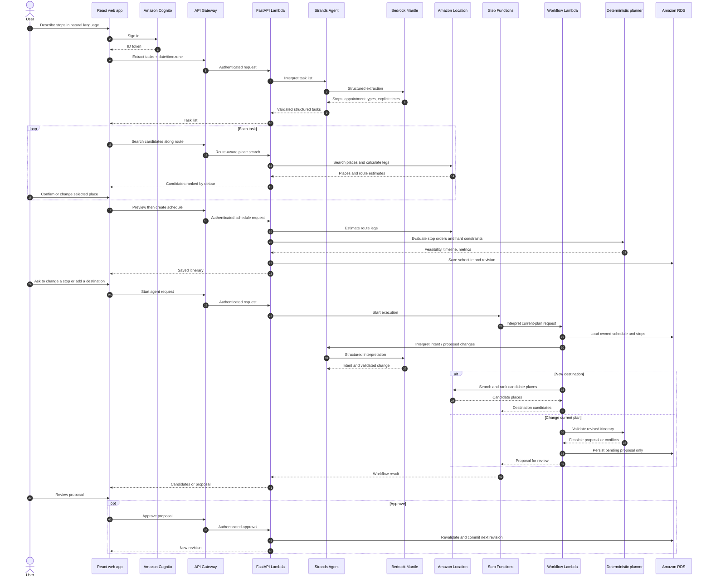
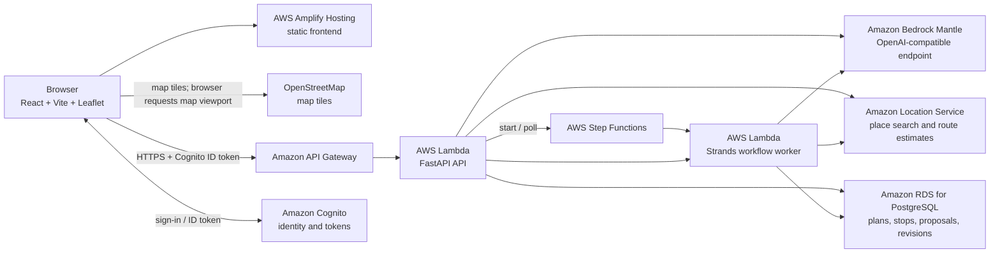
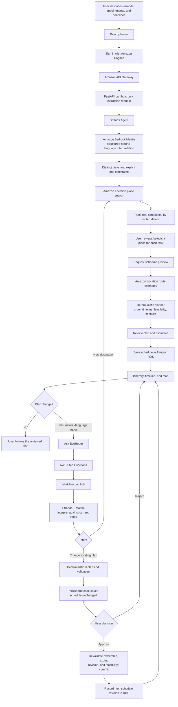

# EcoRoute

> **A busy day should not require a separate car trip for every errand.**
> EcoRoute turns a person's errands, appointments, and deadlines into one
> renewable day plan—and makes the emissions trade-off visible.

[Try the live demo](https://main.d14mdytx6nvwyq.amplifyapp.com) ·
[Open the API](https://5dxn3t8sgh.execute-api.ap-south-1.amazonaws.com/docs) ·
[Environmental Hacks](https://www.wemakedevs.org/aws/env)

## The idea

People often make several isolated out-and-back trips for errands that could fit
into one day. The extra kilometres cost time and fuel. Existing map apps are good
at getting someone from A to B; they do not build a feasible day around a list of
stops, appointment times, arrival deadlines, and a return journey.

**EcoRoute plans the day, not just the next turn.** A person describes what they
need in natural language. EcoRoute identifies the stops, helps select real places,
checks possible visit orders against the available time, and creates a timeline.
When the day changes, the user can ask EcoRoute to adjust the current plan. Every
change is shown as a proposal; the person stays in control of what gets saved.

The environmental nudge is concrete: show the distance in a combined itinerary
versus a simple “one separate round trip per stop” baseline, then show a
transparent emissions scenario. EcoRoute also gives the user a same-distance
public-transport comparison. 

### Why this fits Environmental Hacks

EcoRoute is a **Waste and Energy** entry: it targets avoidable urban travel and
makes lower-emission choices easier to consider. It combines a relatable
everyday problem, an AWS-backed natural-language workflow, constraint-aware
planning, and an impact estimate whose assumptions are visible. The ambition is
not to pretend a prototype knows every bus timetable; it is to make the planning
problem and the potential trade-off understandable and actionable.

## The experience

1. **Say what needs doing.** For example: “Need to visit the pharmacy, grocery
   store and also have a dentist appointment.”
2. **Review the places.** Strands, using Bedrock Mantle, extracts distinct tasks.
   EcoRoute searches for real place candidates, ranks them by added route detour,
   and lets the user confirm or change each match.
3. **Plan a feasible day.** The deterministic planner evaluates stop orders,
   travel estimates, the schedule window, appointment times, arrival deadlines,
   and other hard constraints. The user sees the timeline before saving.
4. **Keep the plan conversational.** Ask “Need to be at the pharmacy by 5pm”
   or “My dentist appointment moved to 6:30pm.” EcoRoute applies the right
   timing semantics to the matching stops and returns a proposal.
5. **Stay in control.** Review the proposed itinerary and conflicts, then approve
   or reject. Approved changes become a new revision; rejected or pending changes
   do not silently overwrite the saved plan.
6. **See the impact.** Compare the combined route with separate out-and-back
   trips and view a clearly qualified public-transport scenario.

### Request and change sequence



## AWS architecture



### User request to approved itinerary



### Why the AWS pieces are used

| AWS service | Role in EcoRoute |
| --- | --- |
| **Amazon Cognito** | Signs users in and supplies identity tokens. The API validates tokens and scopes stored plans to the authenticated subject. |
| **Amazon API Gateway** | HTTPS entry point from the hosted frontend to the API. |
| **AWS Lambda** | Runs the FastAPI endpoints and a separate worker for asynchronous planning requests. |
| **AWS Step Functions** | Orchestrates interpretation, destination discovery, and replan work; the frontend can poll execution status. |
| **Amazon Bedrock Mantle** | OpenAI-compatible inference endpoint used by Strands for task extraction, intent classification, and natural-language replan interpretation. |
| **Amazon Location Service** | Searches real place candidates and calculates route legs used for detour ranking and itinerary estimates. |
| **Amazon RDS for PostgreSQL** | Persists schedules, stops, proposals, preferences, routines, and revision snapshots. |
| **AWS Amplify Hosting** | Hosts the static React/Vite application at the public demo URL. |

### Agent and planner responsibilities

Strands is the natural-language interpretation layer. It uses Mantle-backed
structured outputs to extract tasks, classify a chat request, or describe a
proposed change. The application guardrails does not let the model write database rows,
approve changes, or decide that a schedule is feasible.

The deterministic planner algorithm remains authoritative for ordering stops, calculating
the itinerary timeline, checking hard constraints, and evaluating proposals.
Place search returns candidates—not verified inventory, prices, or opening hours.
The user reviews real locations and consequential schedule changes before
committing them.

## Environmental impact: show the assumptions

EcoRoute separates **route-distance savings** from **emissions estimates**:

- The route baseline is one separate start-to-finish journey per stop. The
  comparison is that baseline versus the combined start → stops → finish route.
- In **Car** mode, the direct tailpipe scenario uses **0.140 kg CO₂ per
  vehicle-kilometre**, based on the [WRI India-specific road transport emission
  factors study](https://shaktifoundation.in/wp-content/uploads/2022/04/WRI-2015-India-Specific-Road-Transport-Emission-Factors.pdf)
  for a gasoline hatchback under 1,400 cc, with an 8% uplift.
- Walking and bicycle modes assume zero direct tailpipe CO₂.
- The public-transport panel compares the same combined-route distance using an
  **illustrative 0.060 kg CO₂e per passenger-kilometre** assumption against the
  solo-car factor. It is a scenario, not a transit route or timetable.
- Values are planning estimates. They are not measurements, a life-cycle
  assessment, or a promise of real-world savings. Actual emissions depend on
  vehicle, fuel, occupancy, transit mode, electricity mix, and actual route.

The interface shows the assumptions and warns about those limits. Public
transport directions and timetables are **not** implemented; EcoRoute must not
claim that a user can follow a transit route from this estimate.

## Demo and current deployment

- **Live frontend:** [main.d14mdytx6nvwyq.amplifyapp.com](https://main.d14mdytx6nvwyq.amplifyapp.com)
- **Live API:** [5dxn3t8sgh.execute-api.ap-south-1.amazonaws.com](https://5dxn3t8sgh.execute-api.ap-south-1.amazonaws.com)
- **API docs:** [interactive OpenAPI docs](https://5dxn3t8sgh.execute-api.ap-south-1.amazonaws.com/docs)
- **Amplify app:** reactjs hosting

## Repository guide

```text
.
├── README.md
├── backend/
│   ├── app/
│   │   ├── main.py              # FastAPI routes and auth boundaries
│   │   ├── strands_agent.py     # Structured Strands/Mantle interpretation
│   │   ├── workflow_worker.py   # Step Functions Lambda task handler
│   │   ├── workflows.py         # Start and poll workflow executions
│   │   ├── planner.py           # Deterministic planning and estimates
│   │   ├── service.py           # Persistence, proposals, approvals, revisions
│   │   ├── integrations.py      # Amazon Location and travel provider
│   │   ├── auth.py              # Cognito JWT validation
│   │   └── schemas.py           # Pydantic API contracts
│   ├── docs/                    # Product brief and API/workflow reference
│   ├── infra/                   # Lambda requirements and Step Functions ASL
│   ├── migrations/              # Alembic database migrations
│   ├── scripts/deploy_backend.ps1
│   └── tests/                   # Planner, API, and AWS-integration tests
└── frontend/
    ├── src/
    │   ├── pages/               # Home, planning, discovery, itinerary, settings
    │   ├── components/          # Chat, forms, timeline, proposals, map
    │   ├── api/                 # Authenticated API client and endpoint modules
    │   ├── context/             # Account and active-plan state
    │   └── hooks/               # Workflow polling
    └── package.json
```

## Local development

### Requirements

- Python 3.12 recommended for parity with the Lambda runtime.
- Node.js and npm.
- Optional AWS resources/credentials for live Cognito, Bedrock Mantle, and
  Amazon Location calls. Local SQLite and mock routing can be used for backend
  development without AWS.

### Backend

In PowerShell:

```powershell
cd backend
python -m venv .venv
.\.venv\Scripts\Activate.ps1
python -m pip install -r requirements.txt
Copy-Item .env.example .env
python -m uvicorn app.main:app --reload --host 127.0.0.1 --port 8000
```

The local default uses SQLite and applies Alembic migrations on startup. Open
[http://127.0.0.1:8000/docs](http://127.0.0.1:8000/docs) for the API. To use
the browser sign-in flow locally, configure a Cognito user pool and app client
in `backend/.env`. For Mantle parsing, configure the OpenAI-compatible Mantle
endpoint, API key, project (if required), and model in the backend environment.
Keep keys out of source control. For live place search and route calculations,
also configure Amazon Location and AWS credentials via your normal AWS profile.

### Frontend

In a second PowerShell terminal:

```powershell
cd frontend
npm ci
'VITE_API_BASE_URL=http://127.0.0.1:8000' | Set-Content .env.local
npm run dev
```

Set `VITE_API_BASE_URL` to the API origin only; the frontend appends `/v1/...`.
The hosted Amplify frontend is already configured for the live API.

### Tests and build

```powershell
cd backend
python -m pytest -q

cd ..\frontend
npm run build
npx --no-install eslint src\components\maps\RouteMap.jsx
```

The backend suite uses local test fixtures; it does not by itself prove AWS
permissions or hosted-service health. The natural-language demo flow and map
have also been smoke-tested against the deployed API and website.


## Built for people who have somewhere to be

EcoRoute makes a more considered journey easier to see: fewer isolated trips,
one feasible day, and a clear invitation to choose lower-impact travel when it
works for the person.
